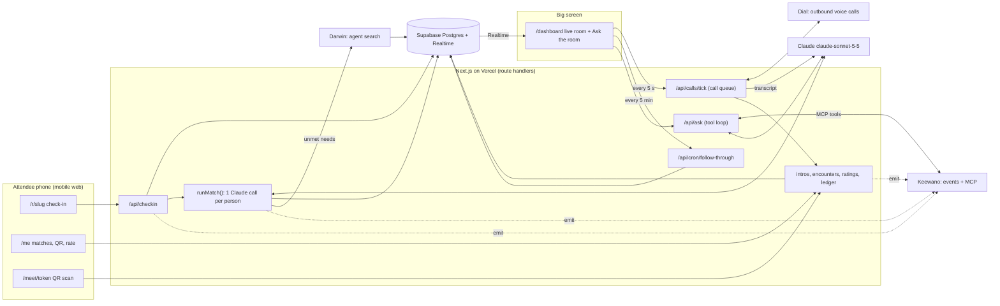

# Sevendipity

**An AI networking agent for in-person events that matches the right people, phones them to explain why, and makes giving visible.**

Built at **SpeedHacks SF (Oct 11, 2026)**.

- Live app: https://speedathon-np.vercel.app (check-in at `/r/speedhacks`, big screen at `/dashboard`, baseline survey at `/survey`)
- Product plan and locked decisions: [PLAN.md](PLAN.md)

---

## The problem

At an event you spend hours talking to the wrong people. The investor you needed was twenty feet away, and the person who introduced you got nothing for it.

Sevendipity removes that bottleneck. It cuts the time from check-in to a *valuable* first meeting, and it gives credit to the people who connect others.

## What it does

1. **Check in** by scanning the event QR. Enter who you are, what you need and what you can give. Or tap **"Let my agent interview me"** and an AI agent phones you for about 90 seconds and fills in your profile from the conversation.
2. **Bilateral matching.** One Claude call compares you against everyone in the room, in both directions: does *they* meet *your* need, and do *you* meet *theirs*? An intro is proposed only if **both sides score at least 6/10**. Each side gets a one-sentence, specific reason to meet.
3. **A call to brief you.** For your top match the agent phones you: "You should meet Priya because… want me to set it up?" A clear *yes* accepts the intro. Everything also works on the web.
4. **Prove you met.** When both accept, you find each other and scan each other's personal QR with the phone's native camera. That confirms the meeting.
5. **Rate it.** Each person rates "how much did they help you?" (0–3), on the web or in a follow-up phone call.
6. **The ledger updates.** Introducers and givers earn credit. The big screen shows the live room and a **Top Connectors** board, and anyone can ask the room questions in plain English.

If nobody in the room can meet a need, Sevendipity searches for an **AI agent** that can, so the person is not left with nothing.

## Screens

| Route | What it is |
|---|---|
| `/r/[slug]` | Event QR target: check-in form, "interview me" option, show-my-name opt-in |
| `/me` | My matches and why, accept/decline, my personal QR, agent suggestions for unmet needs, "introduce two people", rate my meetings, my **private** balance |
| `/meet/[qr_token]` | Opened by a phone camera scanning someone's QR; records "we met" |
| `/p/[id]` | Public giving profile: give score, verified intros, helpfulness. Never a balance |
| `/dashboard` | Big screen: live room graph, Top Connectors, metrics, activity feed, **Ask the room** |
| `/survey` | One-tap baseline: "how long until you meet someone useful at events like this?" |

---

## How we use the SpeedHacks sponsor tools

All three are load-bearing: removing one removes a core feature, not just a nice-to-have.

### Dial: the agent that phones people

Dial places real outbound voice calls with an AI agent. We use three kinds, each with a short script (`lib/dial/scripts.ts`):

| Call | Trigger | What happens |
|---|---|---|
| **Intake** (~90 s) | Person chose "interview me" at check-in | Agent asks who they are, what they need, what they offer. The transcript is turned into a profile, then matching runs |
| **Briefing** | An intro is proposed for the person's top match | Agent explains why they should meet, asks yes/no. A clear yes accepts the intro |
| **Follow-up** | About 30 min after two people are confirmed met | Agent asks "how much did they help you, 0 to 3?" and records the rating in the ledger |

How it works (`lib/dial/`):
- **A queue, not fire-and-forget.** Calls are rows in `call_jobs`. `POST /api/calls/tick` starts queued jobs (max 2 at a time, Dial's limit), polls in-flight calls, handles busy/no-answer retries, and applies results. The always-open `/dashboard` pings it every 5 seconds, because Vercel's free cron is daily.
- **Transcript to data.** After each call Claude extracts structured JSON from the transcript (`lib/dial/extract.ts`): a profile for intake, `yes/no/unclear` for briefings, `0–3` for follow-ups. Mis-heard fragments are dropped instead of stored.
- **Results flow into the product logic** through `lib/dial/bridge.ts`, which calls the same intro and rating functions the web routes use. A call answer and a button tap take the same code path.
- **Calls need consent.** Only people who chose the interview (and gave a phone number) are ever called. Briefings name the other person only if they opted in to being named.
- **Every call has a web fallback.** A failed, empty or unanswered call never blocks anyone; the same step is available on `/me`. `DIAL_DISABLED=1` is a kill switch.

Verified with real calls: an 86 s intake call that filled a profile and triggered matching, a 34 s briefing call answered "yes", and a 56 s follow-up call that recorded a rating of 3.

### Keewano: every event, and the agent that answers questions about them

Every state change in the product (check-in, match, intro, accept, QR scan, rating, ledger credit, unmet need, call result) is sent to **Keewano** as one of **20 custom events** (`lib/keewano.ts`). The person's UUID is the Keewano entity. Keewano then powers two things:

1. **"Ask the room."** The dashboard has a question box. `POST /api/ask` connects to Keewano's **MCP server** with a personal access token, hands Claude a short allow-list of Keewano's tools (SQL, event types, the SQL guide, data tables), and runs a tool-use loop. Claude writes the SQL itself and answers from live data, for example *"Which needs are going unmet?"*, *"How fast do people get to a first meeting?"*, *"Who is the biggest connector tonight?"*. A `lookup_people` tool maps ids to display names and respects each person's name opt-in.
   - **Giving is public, taking is private.** The agent is instructed never to report any individual's take/debit or balance, and it refuses. Aggregates are fine.
2. **Follow-through weighting.** Each person has a follow-through score (0–1): how reliably they accept intros and then actually meet. The matcher ranks candidates by `combined × (0.7 + 0.6 × follow_through)`, so reliable people surface first. A one-tap **baseline survey** at `/survey` records how long people say it usually takes them to meet someone useful (event 2019), so tonight's measured time-to-meeting (the dashboard's median tile, and event 2015 in Keewano) can be compared against a "before" number by asking the room.

How the transport works: events are buffered, grouped per person and sent after the HTTP response (`after()`), so Keewano can never slow or break a request. The event map is registered once per server instance. Events take about 5 minutes to become queryable in Keewano.

### Darwin: an agent when no human fits

After matching, any of a person's needs that **no one in the room can meet** (no candidate scored 6 or higher) is sent to Darwin's Search API (`lib/darwin.ts`) with the person's profile as context. The top results are stored in `agent_matches` and shown on `/me` as an **"An agent can help with this"** card, below the human matches. The product stays about people; Darwin covers the gaps.

What we saw on real queries: *"pre-seed investor who knows neurotech"* returned the `search_investors` agent with Darwin's reasons and connection details, while *"help drafting SAFE documents for a pre-seed startup"* returned a genuine `no_match`. That second case is a concrete coverage gap worth reporting.

---

## The reciprocity ledger

Two separate numbers, as in the Social Capital concept (Phase 2):

- **Give score** (public): the sum of all positive ledger credit, shown on the Top Connectors board.
- **Balance** = give − take (**private**, shown only to its owner as "reciprocity, not reputation"). A student should not be penalised for needing help.

Credit comes from two mechanisms:

| Mechanism | Rule |
|---|---|
| **Human introducer stages** | Introducer earns **+0.2** when both accept, **+0.3** when they meet (QR), **+0.5** when both rate ≥ 2 (total 1.0). The two people introduced are debited the same amounts, so **the ledger always sums to zero** |
| **Value flow** | When *R* rates *E* as `r` (0–3): *E* gains `r/3`, *R* loses `r/3`. Equal mutual help nets to zero |

Each stage pays exactly once, even under concurrent requests (conditional updates in `lib/ledger.ts`).

## Privacy by design

- Phone numbers never reach the browser; the browser cannot read the `people` table at all.
- Names appear publicly only after the person opts in. Others show as "A founder", and so on.
- Nobody's balance or take side is shown on the dashboard, public profiles or in Ask the room.
- The browser uses a read-only anon key on public views; the service-role key only exists in server route handlers.
- All seed data is fictional (25 profiles, no phone numbers, `is_seed = true`).

---

## Architecture



**Stack:** Next.js 16 (App Router, TypeScript, React 19) on Vercel; Supabase (Postgres, Realtime, row-level security); Claude `claude-sonnet-5-5` through `@anthropic-ai/sdk` with structured outputs; `@modelcontextprotocol/sdk` for the Keewano MCP client; `@getdial/sdk` for calls; Tailwind CSS; `qrcode` for QR codes.

**Key design decisions**
- **One Claude call per check-in, whole room in the prompt.** Matching is semantic, not keyword-based, and scores both directions. The model returns JSON validated against a schema; `combined = round(10 × √(b_fits_a × a_fits_b))` is computed in code, not by the model.
- **Calls and web are the same code path.** Dial results go through the same functions as the buttons, so there is one set of rules and one ledger.
- **No real auth, by design for a one-day event.** Check-in sets a signed httpOnly cookie with the person id.
- **Supabase is the source of truth; Keewano is analytics and agent memory.** Keewano's 5-minute ingestion lag never blocks the app.
- **Every LLM call goes through `lib/llm.ts`** (`generateJSON()`), so the provider is one switch. Claude is the default.
- **Failure never cascades.** `emit()` never throws; Darwin errors are logged and ignored; call failures fall back to the web.

**Data model** (`supabase/schema.sql`): `rooms`, `people`, `matches` (one row per pair, both directions' scores), `intros` (proposed → accepted → met → rated | declined), `encounters` (every QR scan), `ratings`, `ledger_entries`, `call_jobs` (the Dial queue), `agent_matches` (Darwin), plus public views (`public_people`, `public_givers`) that never expose the take side.

---

## What is verified and what is not

Verified end to end on real services:
- Check-in, bilateral matching, intro accept → QR met → ratings → ledger summing to zero.
- Dial: intake, briefing and follow-up calls through the queue, with transcript extraction (see above).
- Keewano: event registration and ingestion, and "Ask the room" answering from real data, including refusing to report a person's take/debit.
- Darwin: real searches, results stored and shown on `/me`.

Limitations, stated plainly:
- **Dial credit.** The demo account's Dial credit is used up, so new phone calls fail until it is topped up. The web flow for every step still works.
- **Follow-through source.** The follow-through score is computed from the `intros` table (accept and meet rates), which holds the same facts as Keewano events 2006, 2007 and 2010. The plan called for querying Keewano over MCP for it; Ask the room does use Keewano MCP live.
- **Test data in Keewano.** The Keewano project contains a few clearly labelled test events (`checked_in = "t4-test"`) and one test baseline answer from development.
- **Darwin coverage.** Not every need has an agent; some searches return `no_match`.
- **Scope.** This is Phase 1 (AI matching) plus a thin Phase 2 ledger. Graph-based trust propagation, anti-collusion detection and cross-event reputation are roadmap items, not built.

---

## Run it locally

```bash
npm install
cp .env.example .env.local   # fill in the keys below
npm run dev                  # http://localhost:3000, health check: /api/health
npm run seed                 # 25 fictional people, idempotent
```

| Variable | Used for |
|---|---|
| `NEXT_PUBLIC_SUPABASE_URL`, `NEXT_PUBLIC_SUPABASE_ANON_KEY`, `SUPABASE_SERVICE_ROLE_KEY` | Database and Realtime |
| `COOKIE_SECRET` | Signing the identity cookie (`openssl rand -hex 32`) |
| `ANTHROPIC_API_KEY` | Matching, call-transcript extraction, Ask the room |
| `DIAL_API_KEY`, `DIAL_NUMBER` | Outbound calls. `DIAL_DISABLED=1` stops all calling |
| `KEEWANO_API_KEY`, `KEEWANO_PAT` | Event ingestion (project key) and MCP queries (personal access token) |
| `DARWIN_API_KEY` | Agent search |
| `LLM_PROVIDER`, `GEMINI_API_KEY` | Optional: switch to Gemini |

Only `NEXT_PUBLIC_*` variables are readable in the browser.

**Checks and test scripts**
```bash
npm run typecheck && npm run lint && npm run build   # run `npm run build` first on a fresh checkout: it generates Next's route types
npm run dial:extract                                  # canned transcripts → extraction checks, no phone calls
npm run dial:call -- intake +1XXXXXXXXXX "Name"       # one real call to a phone you control (also: briefing, followup)
npm run dial:tick                                     # backup loop for the call queue if the dashboard isn't open
npm run keewano:register -- --ping                    # register the event map and send one test event
```
Only call people who agreed to be called (yourself or teammates).

## Repository map

```
app/                  pages and route handlers (app/api/...)
components/           UI, including the dashboard widgets (CallTicker, FollowThroughTicker, AskRoom)
lib/match.ts          bilateral matching + ranking + Darwin hook
lib/intros.ts         intros, accept/decline, QR encounters
lib/ledger.ts         ledger rules and ratings
lib/dial/             call queue, scripts, transcript extraction, bridge to intros/ledger
lib/keewano.ts        event catalog and transport
lib/keewano-mcp.ts    MCP client      lib/ask.ts  Ask-the-room tool loop
lib/followthrough.ts  follow-through score
lib/darwin.ts         Darwin search
lib/llm.ts            single entry point for structured LLM calls
supabase/schema.sql   schema, views, RLS, Realtime
scripts/              seed, Dial and Keewano test scripts
```

## For contributors

Read [PLAN.md](PLAN.md) and [CLAUDE.md](CLAUDE.md) first. The schema and route contracts are frozen; changes go through Track 1.

- The browser can't read `people` at all (phones). Use `public_people` / `public_givers`, or a server component with `db()`.
- Every state change calls `emit()` from `lib/keewano.ts` with an event ID from PLAN §6a. IDs are append-only.
- `cacheComponents` is off on purpose: read cookies anywhere on the server without Suspense.
- Small PRs into `main`, merged by T1. Run the three checks above before opening one.
